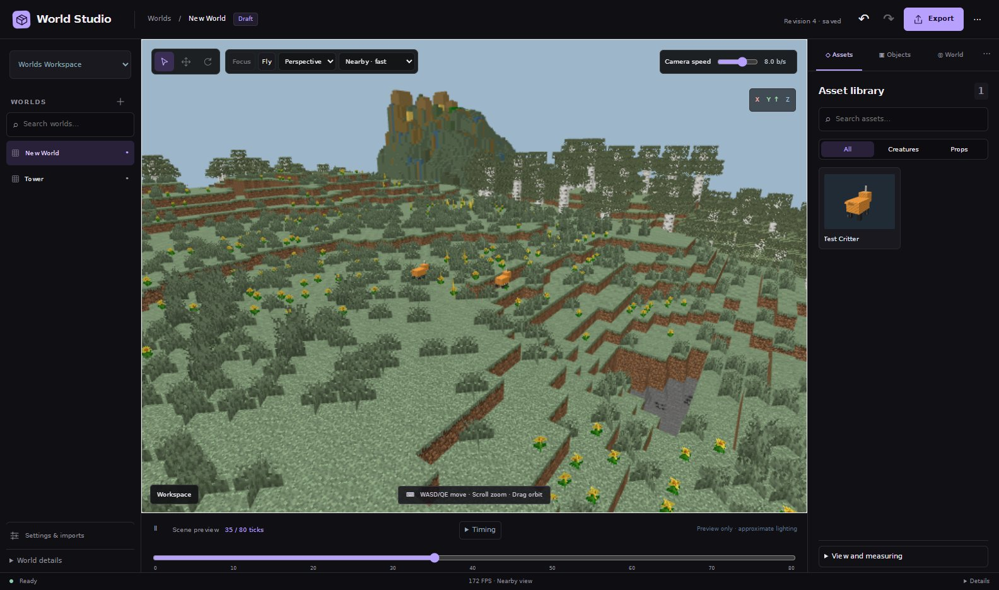

# World Studio

A desktop app for looking at, staging and exporting Minecraft worlds. Open a singleplayer or server save, a WorldEdit schematic or a structure block file, fly around it with real Minecraft block models and textures, place animated Blockbench models in it, and export the terrain as a 3D mesh.



## Features

- **Opens real worlds.** Java Edition saves from 1.13 onward (Anvil), Sponge `.schem`, legacy `.schematic` and structure `.nbt` files. Large worlds stream in tiles with far-terrain detail, and imports run in the background with progress.
- **Looks like Minecraft.** Blocks are rendered from Minecraft's own models and textures, with biome-tinted grass, foliage and water, animated textures and your own resource packs layered on top.
- **Blockbench models.** Drop `.bbmodel` files into the workspace and place them as animated creatures or props. Bones, pivots and keyframe animations are converted automatically.
- **Scene editing.** Move and rotate objects with gizmos, group and lock them, undo and redo with full revision history, scatter creatures over a material, and preview particles.
- **Mesh export.** Export the loaded terrain, or a box of it, to glTF (`.glb`), OBJ (with MTL and atlas) or PLY for Blender, game engines or 3D printing.
- **Extensible.** Add import formats by dropping a Java source file into the workspace's `codecs/` folder; it is compiled when you press Refresh. See [docs/codecs.md](docs/codecs.md).

## Download

Grab the latest build from [Releases](https://github.com/Frcsty/WorldStudio/releases):

- **Windows:** extract `World-Studio-win32-x64.zip` and run `Launch World Studio.cmd`.
- **Linux:** extract `World-Studio-linux-x64.tar.gz` and run `./Launch World Studio.sh`. See the bundled `README.txt` for requirements.

Java and everything else are bundled. On first launch World Studio asks to download Minecraft's block assets from Mojang (about 40 MiB); nothing from Minecraft is shipped with the app.

## Using it

1. **Import a world.** Open **Import world**, then **Browse world…** for a save folder (it starts in `.minecraft/saves`) or **Browse file…** for a schematic or structure. For big saves you can limit the import to a radius around spawn, and pick the Nether or the End.
2. **Explore.** Drag to orbit, right-drag to pan, scroll to zoom, `WASD`/`QE` to move, or turn on **Fly**. The **Nearby / Balanced / Full** picker trades view distance for speed.
3. **Place models.** Use **Import Blockbench model…** in the Setup panel, then pick the model in **Assets** and place it on the terrain.
4. **Export.** **Export** saves the scene as JSON, and **··· → Export mesh…** saves terrain as `.glb`, `.obj` or `.ply`.

### The workspace

Everything you create lives in one folder: `workspace/` next to the app, or your user data folder otherwise. Set `WORLD_STUDIO_WORKSPACE` to use another one.

| Folder | Contents |
| --- | --- |
| `setups/` | Setup definitions and their imported worlds, projects and history. |
| `models/` | Blockbench `.bbmodel` files. Put props in `models/props/`. |
| `resourcepacks/` | Resource pack folders or `.zip` files, layered over vanilla in name order. |
| `codecs/` | Import format plugins (`.java` or `.jar`). |
| `render/default/` | The generated render bundle. Rebuild it from the Setup panel. |
| `cache/` | Downloads and other files that can be regenerated. |

Source files you import are only read, never modified.

## Building from source

You need **Node.js 22.12+** and a **Java 25 JDK** (`java`, `javac` and `jlink` on `PATH`).

```sh
npm run setup     # install dependencies for the tools, UI and desktop shell
npm run build     # compile the Java host and the UI
npm run assets    # download Minecraft assets into ./workspace
npm start         # launch the desktop app on ./workspace
```

Package a standalone build on the target operating system:

```sh
npm run package:win     # on Windows: desktop/dist/World Studio-win32-x64/
npm run package:linux   # on Linux:   desktop/dist-linux/World Studio-linux-x64/
```

Command-line tools work on the same workspace and don't need the app running:

```sh
node tools/studio.mjs import-world worlds my-world anvil "/path/to/saves/My World" radius=512
node tools/studio.mjs worlds worlds
node tools/studio.mjs export-world worlds my-world json-sections-v1 exports/my-world.json
```

### Project layout

| Path | What it is |
| --- | --- |
| `app-host/` | Java 25 host: world codecs, snapshot storage, projects and revisions, the local HTTP API. |
| `ui/` | React and three.js interface, terrain mesher and streaming. |
| `desktop/` | Electron shell and packaging. |
| `tools/` | Asset installer, Blockbench converter, build and CLI scripts. |
| `workspace-template/` | The clean workspace every install starts from. |
| `examples/` | A sample codec plugin, a tree workshop and procedural world generators. |

The desktop app starts the Java host on a random loopback port and loads the UI from it. Nothing listens on the network, and write requests need a per-session token.

## License

MIT, see [LICENSE](LICENSE). Third-party components are listed in [THIRD_PARTY_NOTICES.md](THIRD_PARTY_NOTICES.md).

World Studio is not an official Minecraft product and is not approved by or associated with Mojang or Microsoft.
